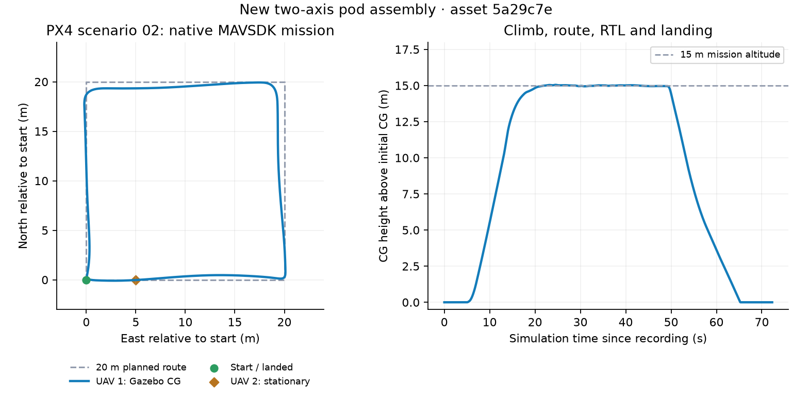
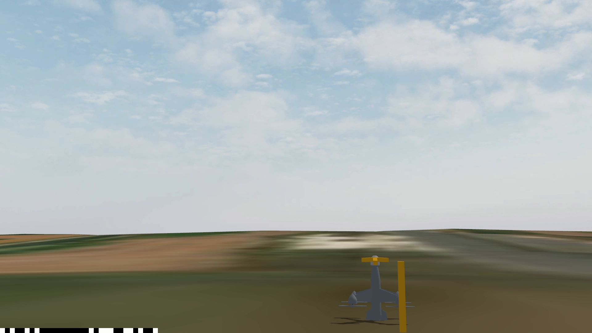
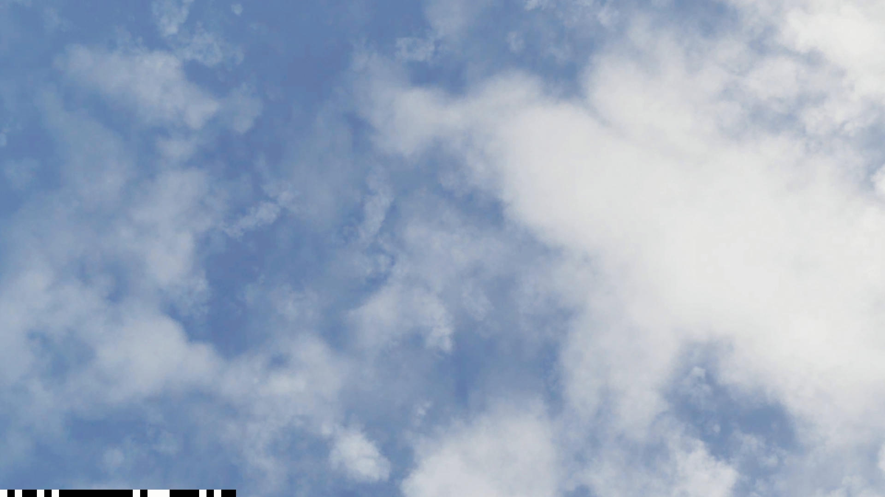

# 02 场景新两轴组合飞机验证

当前双机场景已通过新吊舱继承、机械/光学接口、两路视频隔离、目标/雷达联合通路，以及1号机原生MAVSDK航线与落地验证。2号机在飞行测试中保持地面待命。

验证日期：2026-10-21。资产仓版本 `5a29c7eef09a078fdae721a376dd2101c9832d73`；验证使用的PX4仓库基线为 `f5dfb30c87a037a67646be7aaed3c3fa520257fc`，场景实现按源码指纹核对。运行世界SHA256为 `ea8c2e40e61dfd4041cc88c7b58622e9db0638d1ee687f1fad8762d0af270adc`。源码、二进制、生成模型与配置指纹见 [validation.json](validation.json)，原始数据和复验辅助脚本见 [validation_evidence.tar.gz](validation_evidence.tar.gz)。

## 当前集成配置

每机为5 kg动态组合模型，12个link、11个joint，保留9个新CAD物理mesh碰撞体与26个原生接触传感器。实际运行模型逐项继承资产仓的几何、惯量、活动关节及控制器；场景只增加实例命名、逐机接口、世界出生姿态和接触传感器。

吊舱保留原始CAD零位：光轴沿机体+Z，外轴沿−X、范围±60°，内轴沿随动−Y、范围−80°～+30°，协议v6 / `motion_head_joint`。镜头相对球心沿局部+Z偏移23.7 mm。

默认起飞格点为 `(5.25,5)`、`(10.25,5) m`，避开雷达杆和地形三角面的共边。出生高度继承各生成模型的 `simulation.spawn_pose`（当前0.215 m），按真实地形高度和法线放置；尾部法向间隙约4.77 mm。独立静止物理预检覆盖出生后20.056秒，双机最大倾角约2.665°/2.711°，8个旋翼全程无地形接触。标志为无碰撞的 `POD_LOCATION_MARKER_1/2`。

场景靶机交会采用各物理collision的实时姿态。9个DAE的局部包围盒包含实际顶点、节点变换和缩放，保留非零局部中心；检测盒只用于保守OBB交会，原生mesh物理几何完整保留。9个DAE与Gazebo MeshManager包络的最大误差为6.94e−18 m。场景Python回归54项、光学数学回归8项、C++几何目标1项、原有Gazebo碰撞7例、新mesh碰撞6例通过。

## 实测结果

| 项目 | 结果 |
|---|---|
| 原生MAVSDK航线 | 20 m见方、15 m相对高度、5 m/s设定，Mission 5/5、RTL、落地并停机 |
| Gazebo独立真值 | 每机1514条，四角按序命中；角点验收半径6 m，真值最大间隔0.060 s |
| 最大爬升/水平距离 | 15.0445 m / 27.1305 m |
| 最终返航位置误差 | 0.00934 m；高度差0.000236 m |
| 2号机全程最大位移 | 0.000006210 m |
| 落地稳定性 | 两机未解锁、已落地、静止；全程8个旋翼无地形接触 |
| 云台 | 两机双轴运动、四端限位、控制隔离、实际轴心与光学姿态全部通过 |
| 实际光学机械误差上限 | 0.008631°；光学与遥测误差0.008609° |
| 球心/镜头中心误差上限 | 5.69e-07 m / 3.6e-06 m |
| 两路视频 | 各自ID、RTSP路径、帧戳/帧表独立匹配；非对称光轴画面隔离通过，NVENC/NVDEC |
| 目标与雷达 | 同一次最终场景的8秒联合测试通过；测试结束后目标和雷达均停止 |



位置统计来自Gazebo实际机体姿态旋转后的固定零关节名义CG，参照起飞前位置；高度不是地形逐点AGL。最后位置误差是本次仿真实测值，未作为精度保证。航点经过判据为6 m半径，图中可查看实际转弯轨迹。

## 视频隔离与复验入口

1号镜头转向地平线，2号保持零位朝天；采集后两机云台均回零、停止。

| 1号实际解码画面 | 2号实际解码画面 |
|---|---|
|  |  |

启动命令：

```bash
GIMBAL_PYTHON=../px4-gazebo-assets/.venv-linux/bin/python \
bash scenarios/02_rocket_two_axis_pod/start.sh -n 2 --gui --advertise-host 127.0.0.1
```

浏览相机近裁剪0.005 m；近景灵敏度服务与逐机地面站命令见[场景说明](../README.md)。本机已安装的定制MAVSDK使用 `udpin://0.0.0.0:14440` 时实际绑定14540，连接实例0的14580→14540接口；这次直接运行已有原生 `mavsdk_route_test`，未改SDK或飞控源码。完整调用、只读双机真值记录与有界自主降落保护脚本均包含在证据包中。

默认2 km距离、中心高度加100 m的靶机仰角约3°，受新两轴机械可达域约束；本报告的雷达检出和真值通路通过，不表示该默认远目标已完成镜头中心锁定。网格交会采用保守外接盒，会包含网格空腔和盒角。

PX4场景仍沿用运行副本 `EKF2_HGT_REF=1` 的既有GPS高度参考设置；生成模型和资产仓原文件保持继承值。用户已有消息文件SHA256保持 `c08c987c6fa9a556f3bb66ec2323415cecee567fb3875c37e8dbce106cb68b89`。资产仓5a29c7e已提交并推送。
